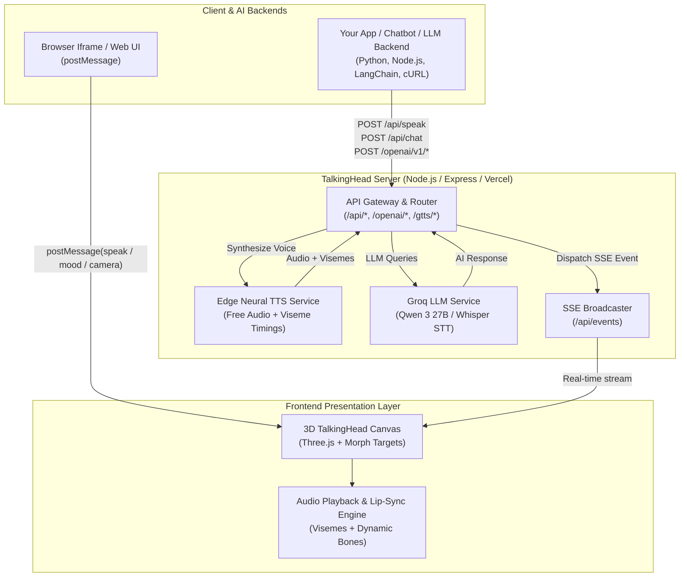

<div align="center">

# 🗣️ TalkingHead 3D

### Give any chatbot or AI assistant a living face. A real-time 3D talking avatar controlled with one API call.

Realistic lip-sync · Free neural voices · OpenAI-compatible proxy · REST, SSE & iframe APIs · Works with any LLM backend

[](LICENSE)

[](CONTRIBUTING.md)
[](https://github.com/thesuraj01/TalkingHead)


[Quick Start](#-quick-start) · [API Reference](#-api-reference) · [OpenAI Compatibility](#-openai--cloud-ai-compatibility) · [Integration Recipes](#-integration-recipes) · [Environment Variables](#-configuration--environment-variables) · [Roadmap](#-roadmap) · [Contributing](#-contributing)

</div>

---

## ✨ Why TalkingHead?

Most AI assistants are a plain text box. **TalkingHead** turns your chatbot, voice assistant, customer support bot, or LLM agent into an **expressive, lifelike 3D character people can see and hear**: an animated avatar with accurate real-time lip-sync, customizable moods, natural gestures, and dynamic camera angles—all driven by simple HTTP requests.

- 💸 **Zero-cost neural voices:** Out-of-the-box text-to-speech using high-quality Microsoft Edge Neural voices. No TTS API key, subscription, or billing required.
- ⚡ **Plug-and-play with any backend:** Compatible with Python, Node.js, LangChain, LlamaIndex, FastAPI, or any HTTP client.
- 🧠 **Integrated Groq LLM & OpenAI proxy:** Built-in `/api/chat` powered by Qwen 3 27B on Groq, plus drop-in OpenAI SDK compatibility (`/openai/v1/*`).
- 👄 **Real-time lip-sync:** Viseme generation supporting English, Finnish, German, French, Brazilian Portuguese, and Lithuanian.
- 🎭 **Gestures & Moods:** 8 facial expressions (`happy`, `sad`, `love`, etc.) and 8 body gestures (`namaste`, `thumbup`, `ok`, `shrug`, etc.).
- 🎥 **Dynamic camera framing:** Switch between `head`, `upper`, `mid`, and `full` camera angles on the fly.
- 🖥️ **Minimal Service View:** Press `F2` or invoke `/api/mode` for a borderless, menu-free 3D viewport tailored for streaming, OBS, and dashboards.
- 🌐 **Embeddable anywhere:** Drop the avatar into any web application using an `<iframe>` and control it effortlessly via `window.postMessage`.
- ☁️ **Vercel & Docker ready:** Serverless setup pre-configured with `vercel.json` and Express fallback.

---

## 🎯 Feature Overview

| | Feature | Details |
|---|---|---|
| 🎭 | **3D Avatar Engine** | Full-body GLB/glTF avatar rendering with Mixamo-compatible skeletal animations and morph targets |
| 👄 | **Real-Time Lip-Sync** | Real-time visemes for English (`en`), Finnish (`fi`), German (`de`), French (`fr`), Brazilian Portuguese (`pt-BR`), and Lithuanian (`lt`) |
| 😊 | **Moods & Expressions** | `neutral`, `happy`, `sad`, `angry`, `fear`, `disgust`, `love`, `sleep` |
| ✋ | **Gestures** | `namaste`, `thumbup`, `thumbdown`, `ok`, `handup`, `index`, `side`, `shrug` |
| 🎥 | **Camera Framing** | Seamless transitions between `head` (close-up), `upper` (chest), `mid` (waist), and `full` (full body) |
| 🔊 | **Free Neural TTS** | High-definition Microsoft Edge Neural voices (with optional Google Cloud TTS fallback) |
| 🤖 | **Built-in AI Chat** | Conversational chat endpoint powered by Qwen 3 27B on Groq (`/api/chat`) |
| 🔄 | **OpenAI API Proxy** | Drop-in proxy for `/v1/chat/completions`, Whisper `/v1/audio/transcriptions`, and `/v1/moderations` |
| 📡 | **Integration Channels** | HTTP REST, Server-Sent Events (SSE) stream (`/api/events`), and `iframe` `postMessage` |

---

## 🧩 Architecture & Data Flow



---

## 🚀 Quick Start

### Prerequisites
- [Node.js](https://nodejs.org/) v18.0.0 or higher
- Optional: A free [Groq API Key](https://console.groq.com/keys) (only required if using `/api/chat` or the OpenAI proxy)

### 1. Clone the repository
```bash
git clone https://github.com/thesuraj01/TalkingHead-3D.git
cd TalkingHead-3D
```

### 2. Install dependencies
```bash
npm install
```

### 3. Configure environment variables
Copy `.env.example` to `.env`:
```bash
cp .env.example .env
```
Open `.env` and set your preferred configuration (speech works out of the box with zero keys; add `GROQ_API_KEY` for conversational AI):
```env
PORT=3000
GROQ_API_KEY=your_groq_api_key_here
JWT_SECRET=talkinghead-secret-key-change-me
```

### 4. Run the project

Choose the mode that fits your workflow:

```bash
# Option A: Start the Express server directly
npm start

# Option B: Build production frontend and start server
npm run execute

# Option C: Start Vite dev server for hot-reloading frontend development
npm run dev
```

Open **`http://localhost:3000`** in your browser to see your 3D avatar.

### 5. Make the avatar speak!

Send a quick test request from your terminal:
```bash
curl -X POST http://localhost:3000/api/speak \
  -H "Content-Type: application/json" \
  -d '{
    "text": "Hello! I am your new 3D conversational assistant.",
    "mood": "happy",
    "gesture": "thumbup",
    "camera": "upper"
  }'
```

---

## 📜 NPM Scripts Reference

| Command | Description |
|---|---|
| `npm start` | Launches the backend server with `node server.js` |
| `npm run dev` | Starts the Vite development server with hot-reloading |
| `npm run build` | Compiles the production bundle into the `dist/` folder |
| `npm run preview` | Locally previews the Vite production build |
| `npm run execute` | Builds the frontend bundle and runs the server (`npm run build && npm run start`) |
| `npm test` | Runs the automated API test suite (`node test-endpoints.mjs`) |

---

## 📡 API Reference

### Core Avatar Endpoints

| Method | Endpoint | Description |
|---|---|---|
| `POST` | `/api/speak` | Speaks text with synchronized lips, mood, gesture, and camera framing |
| `GET` | `/api/speak?text=...` | Quick trigger speech via HTTP GET query parameters |
| `POST` | `/api/chat` | Queries Qwen 3 27B on Groq and speaks the response automatically |
| `POST` | `/api/gesture` | Triggers a hand/body gesture |
| `POST` | `/api/mood` | Changes avatar facial expression/mood |
| `POST` | `/api/camera` | Updates camera framing (`head`, `upper`, `mid`, `full`) |
| `POST` | `/api/mode` | Toggles between `service` (minimal borderless) and `full` UI |
| `POST` | `/api/stop` | Stops any currently active speech and resets animations |
| `POST` | `/api/tts` | Generates standalone Edge Neural TTS audio and timepoints |
| `GET` | `/api/events` | Server-Sent Events (SSE) stream for real-time avatar events |
| `GET` | `/api/status` | Returns system status, active clients, and available options |
| `GET` | `/health` or `/api/health`| Health check endpoint returning uptime and status |
| `GET` | `/app/jwt/get` | Issues a signed JWT SSO token for authenticated client sessions |

---

### Detailed Endpoint Payloads

#### 1. `POST /api/speak`
Dispatches speech, facial expression, gesture, and camera positioning to all active avatar clients:

```bash
curl -X POST http://localhost:3000/api/speak \
  -H "Content-Type: application/json" \
  -d '{
    "text": "Welcome! How can I help you today?",
    "mood": "happy",
    "gesture": "namaste",
    "camera": "upper",
    "voice": "en-US-JennyNeural",
    "flush": true
  }'
```

##### Supported Payload Fields:
| Parameter | Type | Allowed Values / Examples | Description |
|---|---|---|---|
| `text` | `string` | *(Required)* Any plain text | Text to speak with real-time lip-sync. |
| `mood` | `string` | `neutral`, `happy`, `sad`, `angry`, `fear`, `disgust`, `love`, `sleep` | Facial expression during speech. |
| `gesture` | `string` | `namaste`, `thumbup`, `thumbdown`, `ok`, `handup`, `index`, `side`, `shrug` | Hand/arm gesture animation. |
| `camera` | `string` | `head` (close-up), `upper` (chest), `mid` (waist), `full` (full-body) | Camera view framing. (Also accepts `view` or `frame`). |
| `voice` | `string` | e.g. `en-US-JennyNeural`, `en-US-GuyNeural`, `en-GB-SoniaNeural` | Edge Neural TTS voice. |
| `rate` | `number` | `-0.5` to `1.0` (default: `0.0`) | Speech rate modifier. |
| `pitch` | `number` | `-0.5` to `0.5` (default: `0.0`) | Pitch modifier. |
| `flush` | `boolean` | `true` or `false` | When `true`, immediately cancels previous speech queue. |

---

#### 2. `GET /api/speak` (Quick Trigger)
Call directly from browser address bars, webhooks, or simple scripts:
```text
GET http://localhost:3000/api/speak?text=Hello+world&mood=happy&gesture=ok&camera=head
```

---

#### 3. `POST /api/chat` (AI Chatbot)
Generates an AI response using **Qwen 3 27B on Groq** and streams it straight to the avatar:
```bash
curl -X POST http://localhost:3000/api/chat \
  -H "Content-Type: application/json" \
  -d '{
    "prompt": "Explain black holes in one short sentence.",
    "systemPrompt": "You are an enthusiastic astrophysics teacher.",
    "mood": "happy",
    "gesture": "index",
    "camera": "upper"
  }'
```

---

#### 4. `POST /api/gesture` & `POST /api/mood`
Control avatar animation independently of speech:
```bash
# Trigger gesture
curl -X POST http://localhost:3000/api/gesture \
  -H "Content-Type: application/json" \
  -d '{"gesture": "thumbup", "duration": 2500}'

# Set mood
curl -X POST http://localhost:3000/api/mood \
  -H "Content-Type: application/json" \
  -d '{"mood": "love"}'
```

---

#### 5. `POST /api/mode` (Minimal Service View)
Toggle between the standard interactive UI and the sleek, borderless service view:
```bash
curl -X POST http://localhost:3000/api/mode \
  -H "Content-Type: application/json" \
  -d '{"mode": "service", "camera": "head"}'
```
> 💡 **Keyboard Shortcut:** You can also press **`F2`** anywhere in the web app to instantly toggle Minimal Service View.

---

## 🤖 OpenAI & Cloud AI Compatibility

TalkingHead includes built-in proxy routes compatible with official OpenAI and Google AI SDKs:

### 1. OpenAI Chat Completions Proxy
Point any OpenAI-compatible library or client directly to TalkingHead:
- **Endpoint:** `POST /openai/v1/chat/completions`
- Proxies requests to Groq with full streaming (`stream: true`) support.

```python
from openai import OpenAI

client = OpenAI(
    base_url="http://localhost:3000/openai/v1",
    api_key="not-needed"  # Handled by GROQ_API_KEY on the server
)

response = client.chat.completions.create(
    model="qwen/qwen3.8-27b",
    messages=[{"role": "user", "content": "What is the capital of France?"}]
)
print(response.choices[0].message.content)
```

### 2. Groq Whisper Audio Transcription Proxy
- **Endpoint:** `POST /openai/v1/audio/transcriptions`
- Proxies multipart audio uploads directly to Whisper on Groq for ultra-fast speech-to-text.

### 3. Google Cloud TTS & Gemini Proxies
- `POST /gtts/`: Google Cloud Text-to-Speech proxy with automatic, seamless fallback to Free Edge Neural TTS if no key is configured.
- `ALL /gemini/*`: Direct pass-through proxy to Google Gemini API models.

---

## 🔌 Integration Recipes

### 1. Python (LangChain, FastAPI, or Custom Bots)
```python
import requests

TALKINGHEAD_URL = "http://localhost:3000/api/speak"

def avatar_speak(text, mood="happy", gesture="thumbup"):
    payload = {
        "text": text,
        "mood": mood,
        "gesture": gesture,
        "camera": "upper",
        "flush": True
    }
    res = requests.post(TALKINGHEAD_URL, json=payload, timeout=10)
    return res.json()

# In your chatbot flow:
avatar_speak("Order #1042 has been dispatched!", mood="happy", gesture="ok")
```

### 2. Node.js / TypeScript
```typescript
async function sendToTalkingHead(text: string, mood = "neutral", gesture?: string) {
  const response = await fetch("http://localhost:3000/api/speak", {
    method: "POST",
    headers: { "Content-Type": "application/json" },
    body: JSON.stringify({ text, mood, gesture, camera: "upper" })
  });
  return response.json();
}

await sendToTalkingHead("System diagnosis complete. All parameters optimal.", "happy", "thumbup");
```

### 3. Embed in Any Web Page via `<iframe>` (`postMessage`)
Embed the avatar cleanly into any website, dashboard, or app:

```html
<!-- Embed TalkingHead in Minimal Service Mode -->
<iframe
  id="avatarFrame"
  src="http://localhost:3000?mode=service"
  width="450"
  height="600"
  allow="autoplay"
  style="border: none; border-radius: 16px; box-shadow: 0 10px 30px rgba(0,0,0,0.3);">
</iframe>

<script>
  const avatar = document.getElementById('avatarFrame');

  function speak(text, mood = 'happy', gesture = 'thumbup') {
    avatar.contentWindow.postMessage({
      type: 'speak',
      text: text,
      mood: mood,
      gesture: gesture,
      camera: 'upper'
    }, '*');
  }

  // Example trigger:
  window.addEventListener('load', () => {
    setTimeout(() => speak("Welcome to our platform!"), 1000);
  });
</script>
```

### 4. Real-Time Event Stream (Browser EventSource)
```javascript
const events = new EventSource('http://localhost:3000/api/events');

events.addEventListener('speak', (event) => {
  const data = JSON.parse(event.data);
  console.log('Avatar speaking:', data.text, 'Mood:', data.mood);
});
```

---

## ⚙️ Configuration & Environment Variables

Configure your environment in `.env` (or via deployment environment settings):

| Variable | Default | Description |
|---|---|---|
| `PORT` | `3000` | Port for the Express web server |
| `GROQ_API_KEY` | `""` | Groq API key for Qwen 3 27B chat & Whisper STT |
| `JWT_SECRET` | `talkinghead-secret-key` | Secret string for signing frontend SSO session tokens |
| `GOOGLE_TTS_API_KEY` | `""` | *(Optional)* Google Cloud TTS API key (defaults automatically to Edge TTS) |
| `GEMINI_API_KEY` | `""` | *(Optional)* Google Gemini API key if utilizing the `/gemini` proxy |

---

## ☁️ Deployment

### Vercel (Serverless)
TalkingHead is pre-configured for Vercel deployment:
1. Connect your repository to Vercel.
2. Build command: `npm run build`
3. Output directory: `dist`
4. Set `GROQ_API_KEY` and other environment variables in the Vercel project settings.
5. `vercel.json` and `api/index.js` automatically route serverless API and proxy requests.

### Docker & Self-Hosted Linux
Run with Node.js behind Nginx or Caddy:
```bash
npm run build
PORT=3000 npm start
```

---

## 🗺️ Roadmap

- [x] Full-body 3D avatars with Mixamo animations & Three.js r180
- [x] Real-time viseme lip-sync across 6 languages
- [x] 100% Free Edge Neural TTS with timing generation
- [x] Groq LLM integration (Qwen 3 27B) & OpenAI chat completions proxy
- [x] Whisper audio transcriptions proxy
- [x] Minimal Service View mode (`F2` shortcut and `/api/mode`)
- [x] Automated test suite (`npm test`)
- [ ] 🐳 Official Dockerfile & Docker Compose
- [ ] 📦 Official Python and TypeScript client SDKs
- [ ] 🎤 In-browser Speech-To-Text voice conversation loop
- [ ] 🧍 Web UI custom avatar upload and library browser

---

## 🤝 Contributing

Contributions are warmly welcomed! Please read **[contributing.md](contributing.md)** for details on branch naming, code style, and PR guidelines.

1. ⭐ Star the repository
2. 🍴 Fork the project (`git checkout -b feature/amazing-feature`)
3. 🧪 Verify endpoints with `npm test`
4. 📬 Submit a Pull Request

---

## 📚 Engine Reference

For in-depth details on low-level Three.js morph targets, custom avatar rigging, dynamic bones, and phoneme-to-viseme tables, inspect [`public/modules/talkinghead.mjs`](public/modules/talkinghead.mjs) and [`INTEGRATION.md`](INTEGRATION.md).

---

## 🙏 Credits & Acknowledgments

- **TalkingHead 3D Engine & Lip-Sync:** Originally authored by [Mika Suominen (@met4citizen)](https://github.com/met4citizen/TalkingHead). A huge thank you for the foundational work!
- **Avatar-as-a-Service Architecture:** [Suraj Yadav](https://github.com/thesuraj01) (REST, SSE, Free Edge TTS integration, Groq Qwen & Whisper proxies, and service mode).
- **3D Graphics:** [Three.js](https://github.com/mrdoob/three.js/).

---

## 📜 License

Distributed under the [MIT License](LICENSE). Third-party 3D models and animations remain subject to their respective creators' licenses.

---

## 👨‍💻 Author

**Suraj Yadav**  
- GitHub: [@thesuraj01](https://github.com/thesuraj01)  
- Email: thesuraj396@gmail.com  
- Repository: [https://github.com/TheSuraj01/TalkingHead-3D](https://github.com/TheSuraj01/TalkingHead-3D)

<div align="center">

**If TalkingHead 3D helps your project, please give it a ⭐ on GitHub!**
&&
</div>