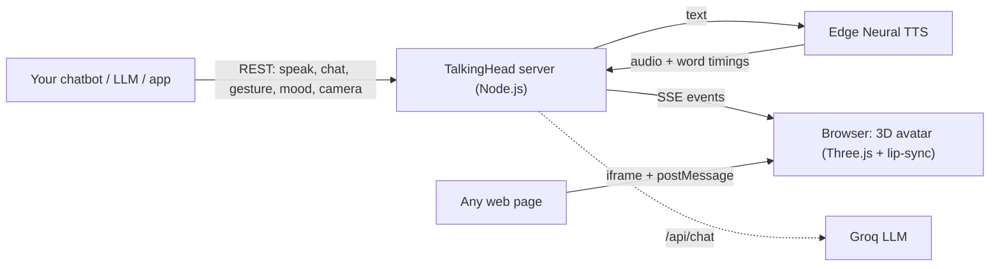

<div align="center">

# 🗣️ TalkingHead

### Give any chatbot a face. A real-time 3D talking avatar you control with one API call.

Realistic lip-sync · Free neural voices · REST, SSE & iframe APIs · Works with any LLM backend

[](LICENSE)

[](CONTRIBUTING.md)
[](https://github.com/thesuraj01/TalkingHead)


[Quick Start](#-quick-start) · [API](#-api-reference) · [Integrations](#-integration-recipes) · [Roadmap](#-roadmap--where-you-can-help) · [Contributing](#-contributing)

</div>

---

## ✨ Why TalkingHead?

Most AI assistants are a text box. TalkingHead turns your chatbot, voice assistant or LLM app into a **character people can see and hear**: a 3D avatar that speaks with accurate lip-sync, shows emotions and makes hand gestures, all driven by simple HTTP calls.

- **Zero-cost voice.** Text-to-speech uses free Microsoft Edge Neural voices. No TTS API key or subscription is needed.
- **Plug-and-play.** It works with Python, Node.js, LangChain or any backend that can send an HTTP request.
- **Real-time.** Lip-sync, moods, gestures and camera framing all update live in the browser.
- **Embeddable.** Drop the avatar into any page with an `<iframe>` and control it with `postMessage`.
- **Open source (MIT).** Fork it, extend it and ship it.

## 🎯 Features

| | Feature | Details |
|---|---|---|
| 🎭 | **3D avatar** | Full-body GLB avatars with Mixamo-compatible rigs |
| 👄 | **Lip-sync** | Real-time visemes. Built-in English, Finnish, German, French, Brazilian Portuguese and Lithuanian |
| 😊 | **Moods and gestures** | `happy`, `sad`, `angry`, `love` and more, plus gestures like `thumbup`, `ok` and `shrug` |
| 🎥 | **Camera control** | Switch between `full`, `mid`, `upper` and `head` framing on the fly |
| 🔊 | **Free TTS** | Microsoft Edge Neural voices out of the box |
| 🤖 | **Built-in AI chat** | Optional `/api/chat` endpoint powered by Qwen 3 on Groq |
| 📡 | **Three ways to integrate** | REST API, Server-Sent Events stream and iframe `postMessage` |

## 🧩 How it works



## 🚀 Quick Start

**Prerequisites:** [Node.js](https://nodejs.org/) v18+ and, optionally, a [Groq API key](https://console.groq.com/keys) for the built-in chat endpoint.

```bash
# 1. Clone
git clone https://github.com/thesuraj01/TalkingHead.git
cd TalkingHead

# 2. Install
npm install

# 3. Configure
cp .env.example .env
# edit .env and set GROQ_API_KEY (optional, only needed for /api/chat)

# 4. Run
npm start
```

Open **http://localhost:3000** and make your avatar talk:

```bash
curl -X POST http://localhost:3000/api/speak \
  -H "Content-Type: application/json" \
  -d '{"text": "Hello! I am your new 3D assistant.", "mood": "happy", "gesture": "thumbup"}'
```

> 💡 **No API keys are needed for speech.** Only `/api/chat` requires `GROQ_API_KEY`.

## 📡 API Reference

| Method | Endpoint | Body | What it does |
|---|---|---|---|
| `POST` | `/api/speak` | `{"text", "mood"?, "gesture"?}` | Make the avatar speak with lip-sync |
| `POST` | `/api/chat` | `{"prompt"}` | Get an AI reply (Qwen 3 on Groq) and speak it |
| `POST` | `/api/gesture` | `{"gesture"}` | Play a hand gesture |
| `POST` | `/api/mood` | `{"mood"}` | Change the avatar's mood |
| `POST` | `/api/camera` | `{"frame"}` | Change camera framing |
| `GET` | `/api/events` | none | Real-time Server-Sent Events stream |

**Moods:** `neutral` · `happy` · `angry` · `sad` · `fear` · `disgust` · `love` · `sleep`  
**Gestures:** `handup` · `index` · `ok` · `thumbup` · `thumbdown` · `side` · `shrug`  
**Camera frames:** `full` · `mid` · `upper` · `head`

```bash
# Ask the built-in AI
curl -X POST http://localhost:3000/api/chat \
  -H "Content-Type: application/json" \
  -d '{"prompt": "Tell me a joke"}'

# Change mood and camera
curl -X POST http://localhost:3000/api/mood   -H "Content-Type: application/json" -d '{"mood": "love"}'
curl -X POST http://localhost:3000/api/camera -H "Content-Type: application/json" -d '{"frame": "upper"}'

# Listen to live events
curl -N http://localhost:3000/api/events
```

📘 Full payload specifications and recipes are in **[INTEGRATION.md](INTEGRATION.md)**.

## 🔌 Integration recipes

### Python (any LLM)

```python
import requests

BASE = "http://localhost:3000"

def say(text, mood="neutral", gesture=None):
    payload = {"text": text, "mood": mood}
    if gesture:
        payload["gesture"] = gesture
    requests.post(f"{BASE}/api/speak", json=payload, timeout=10)

reply = my_llm("What's the weather like on Mars?")  # your own LLM call
say(reply, mood="happy", gesture="index")
```

### Node.js

```javascript
const BASE = "http://localhost:3000";

await fetch(`${BASE}/api/speak`, {
  method: "POST",
  headers: { "Content-Type": "application/json" },
  body: JSON.stringify({ text: "Hello from Node!", mood: "happy" }),
});
```

### Listen to real-time events (browser)

```javascript
const events = new EventSource("http://localhost:3000/api/events");
events.onmessage = (e) => console.log("Avatar event:", e.data);
```

### Embed in any website (iframe)

```html
<iframe
  src="http://localhost:3000"
  width="480"
  height="640"
  allow="autoplay"
  style="border:0; border-radius:16px;">
</iframe>
```

Control the embedded avatar with `window.postMessage`. See [INTEGRATION.md](INTEGRATION.md) for message formats.

## 💡 Ideas to build with it

- 🧑‍🏫 AI tutors and language-learning companions
- 🛎️ Customer-support and website greeter avatars
- 🎮 NPCs and game-show hosts
- 🩺 Wellness and coaching assistants
- 🎙️ Voice-assistant front ends for existing LLM backends
- 📺 Virtual presenters and streamers

## 🗺️ Roadmap: where you can help

This is a community project. These are open areas, so **pick one, open an issue and let's build it together.**

- [ ] 🐳 Official Dockerfile and `docker-compose.yml`
- [ ] 📄 OpenAPI/Swagger spec for the REST API
- [ ] 📦 Official client SDKs (`npm` and `pip`)
- [ ] 🔐 Optional API-key auth and rate limiting
- [ ] 🔌 WebSocket API alongside REST and SSE
- [ ] 🎤 Speech-to-text input for full voice conversations
- [ ] 🌍 More lip-sync languages (see the upstream guide on adding language modules)
- [ ] 🧍 Avatar gallery and custom-avatar upload
- [ ] 🧪 Automated tests and CI (GitHub Actions)
- [ ] 🎨 Themes, backgrounds and a polished control panel
- [ ] 🔗 LangChain, LlamaIndex and Vercel AI SDK examples

## 🤝 Contributing

Contributions of every size are welcome: bug reports, docs fixes, new features, examples and ideas.

1. ⭐ Star the repo
2. 🍴 Fork it and create a branch: `git checkout -b feature/my-idea`
3. 🔧 Make your change and test it locally with `npm start`
4. 📬 Open a pull request describing what and why

Read **[CONTRIBUTING.md](CONTRIBUTING.md)** for the full guide. New here? Look for issues labelled [`good first issue`](https://github.com/thesuraj01/TalkingHead/labels/good%20first%20issue). Questions and show-and-tell posts are welcome in [Discussions](https://github.com/thesuraj01/TalkingHead/discussions).

## ⚠️ Good to know

- **Edge Neural voices** are accessed without an official API contract from Microsoft, so availability can change. For production or commercial deployments, consider switching to a supported service such as Azure Speech.
- **Running beyond localhost?** Put the server behind a reverse proxy with authentication and rate limiting, and never commit your `.env` file.
- **Avatars and assets** have their own licenses. Several example avatars (such as Ready Player Me models) are non-commercial only. Check the terms before using any avatar or animation in a commercial product.

## 📚 Engine reference

The 3D engine's class options, methods, avatar creation guide, lip-sync modules, dynamic bones and streaming APIs are documented in **[docs/ENGINE_REFERENCE.md](docs/ENGINE_REFERENCE.md)**.

## 🙏 Credits

- **TalkingHead 3D engine and lip-sync:** created by [Mika Suominen (@met4citizen)](https://github.com/met4citizen/TalkingHead). This project is built on top of his work. Thank you!
- **Avatar-as-a-Service layer** (REST/SSE/iframe APIs, free Edge TTS and Groq chat integration): [Suraj Yadav](https://github.com/thesuraj01)
- 3D rendering by [three.js](https://github.com/mrdoob/three.js/)

## 📜 License

Released under the [MIT License](LICENSE). The original copyright notice from the upstream project is retained as required. Third-party assets are subject to their own licenses.

## 👨‍💻 Author

**Suraj Yadav**  
GitHub: [@thesuraj01](https://github.com/thesuraj01) · Email: thesuraj396@gmail.com

---

<div align="center">

**If TalkingHead helps you, please ⭐ the repo. It helps others find it!**

[](https://star-history.com/#thesuraj01/TalkingHead&Date)

</div>